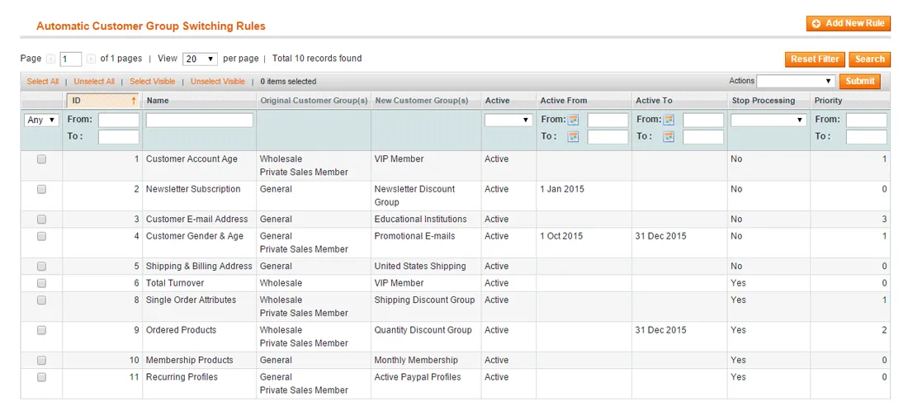
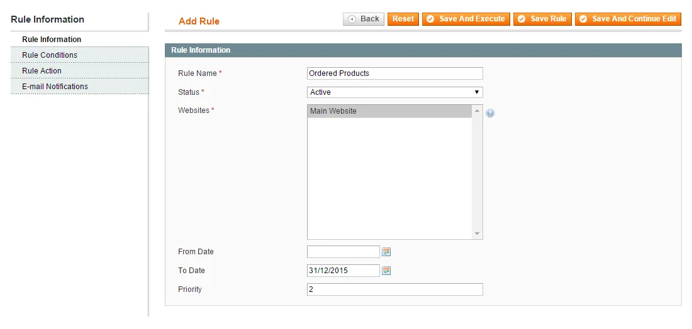
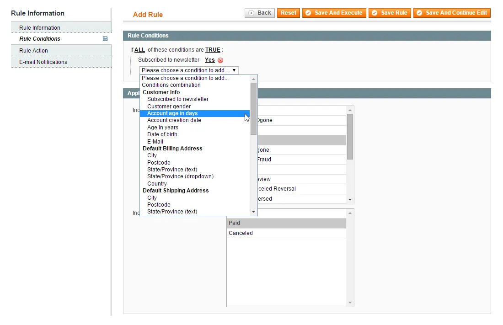
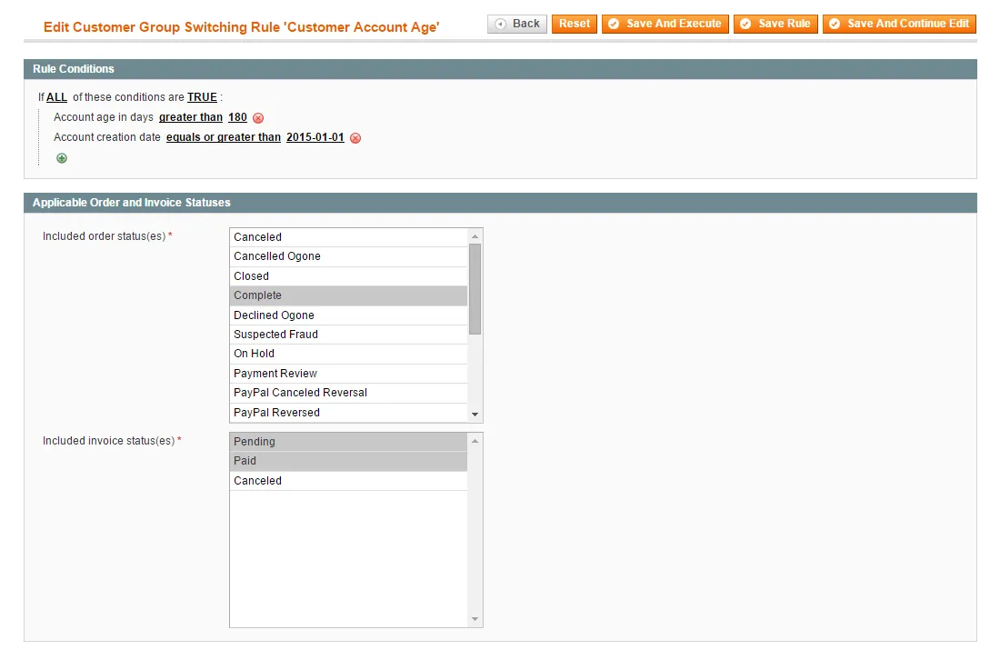
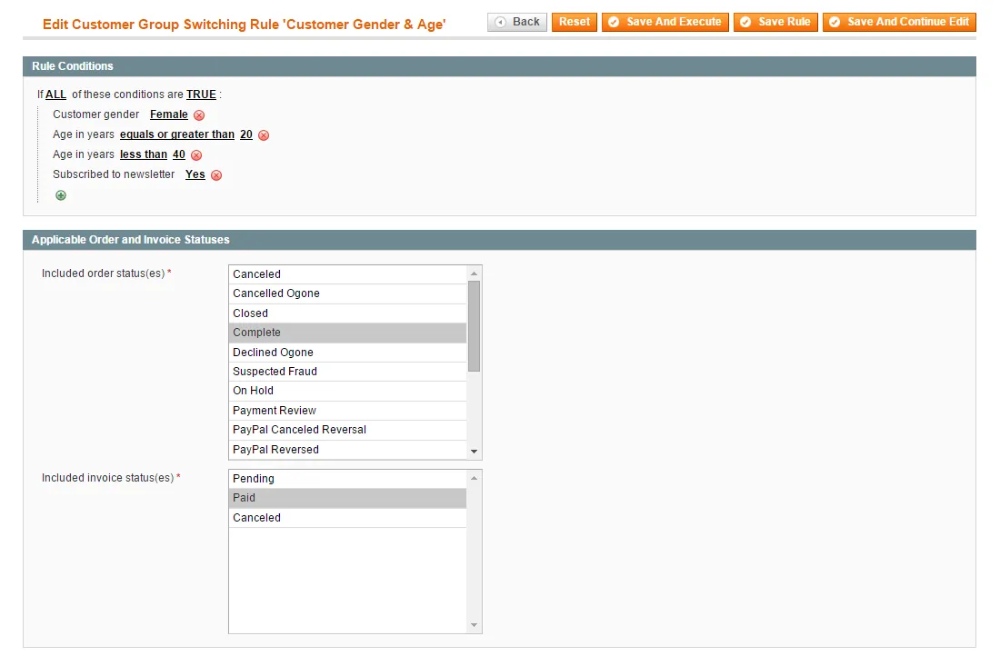
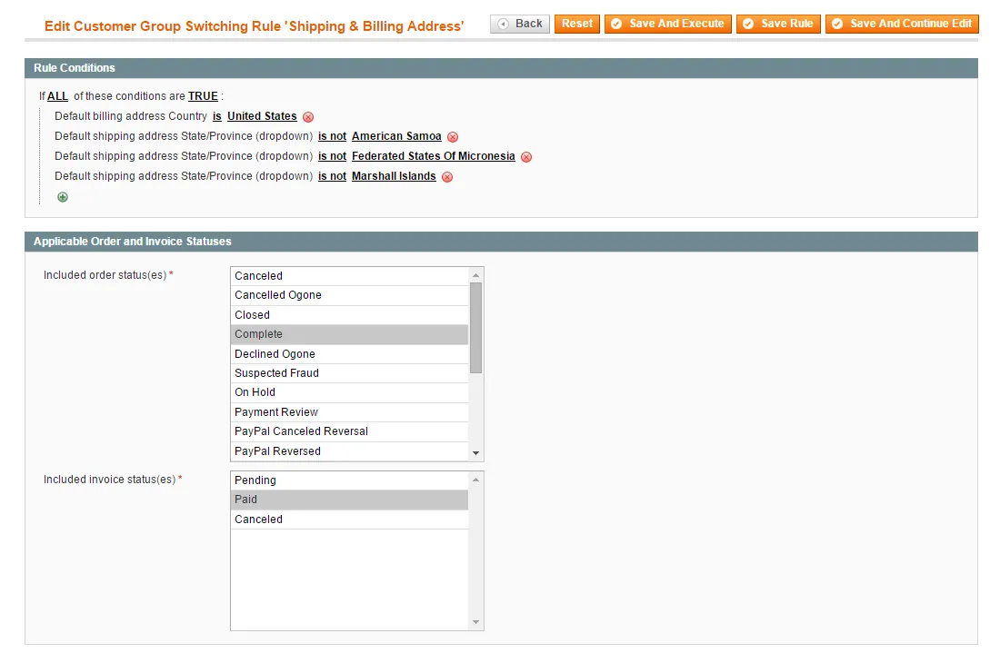
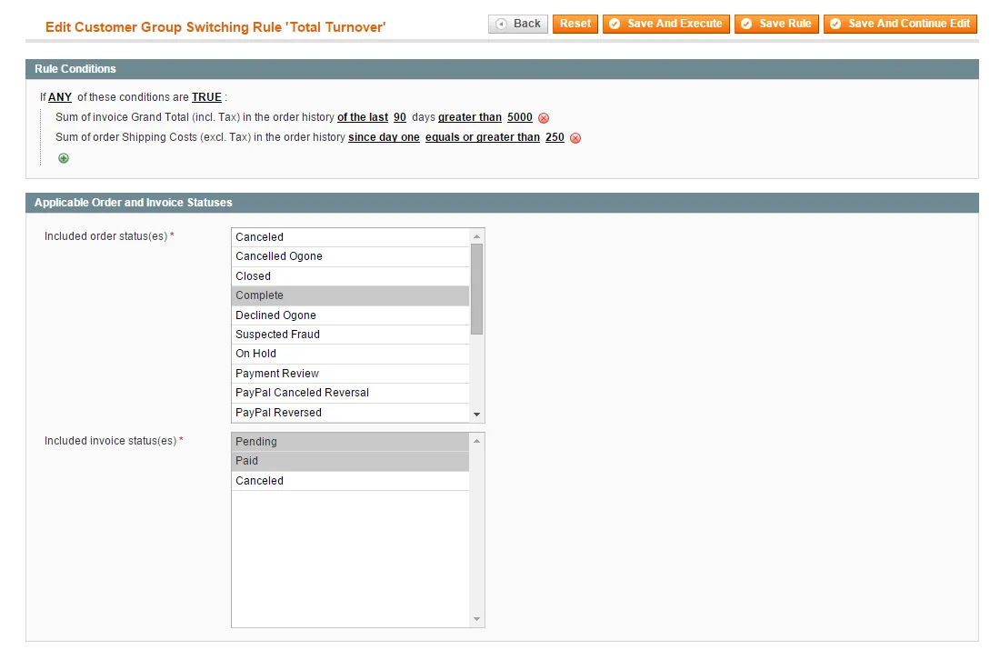

# Automatic Customer Group Switching for Magento 1 / OpenMage

**Moves Magento customers between customer groups based on rules you define.**



Moves customers to another customer group automatically, based on group switching rules.

Rules can use customer and address details, aggregated sales, ordered products, product memberships and recurring profiles, and run on events, on demand or on a schedule.

> [!NOTE]
> Automatic Customer Group Switching is free and open source under the MIT License (since 2026). Plugin Company no longer actively develops this extension, but issues and pull requests are welcome.

## Features

- Rule-based automatic customer group switching
- Conditions on customer attributes and account details
- Conditions on billing and shipping address (city, region, country)
- Conditions on aggregated sales such as total turnover
- Conditions on ordered product attributes
- Order history time frames, e.g. the last 365 days
- Conditions on recurring PayPal profiles
- Product memberships with an expiry period
- Rule priority, active period and processing events
- Run single or multiple rules 'on demand'
- Scheduled batch processing via cron
- Optional e-mail notifications to customers and admins

## Screenshots

<table>
  <tr>
    <td width="50%" valign="top"><br><sub>Create new group switching rule</sub></td>
    <td width="50%" valign="top"><br><sub>Configure group switching rule conditions</sub></td>
  </tr>
  <tr>
    <td width="50%" valign="top"><br><sub>Rule based on customer account information</sub></td>
    <td width="50%" valign="top"><br><sub>Rule based on customer attributes</sub></td>
  </tr>
  <tr>
    <td width="50%" valign="top"><br><sub>Rule based on billing &amp; shipping address</sub></td>
    <td width="50%" valign="top"><br><sub>Rule based on aggregated sales attributes</sub></td>
  </tr>
</table>

More screenshots are on the [product page](https://plugin.company/magento1-extensions/automatic-customer-group-switching.html).

## Compatibility

- **Magento:** Community Edition 1.4.x – 1.9.x, Enterprise Edition 1.8.x – 1.14.x
- **Latest version:** 1.12.1 (released 2020-02-13)
- **Composer package:** `plugincompany/magento1-automatic-customer-group-switching`
- **Module:** `Plugincompany_Groupswitch`

## Installation

### modman

```bash
cd /path/to/magento
modman init   # once per Magento installation
modman clone https://github.com/PluginCompany/magento1-automatic-customer-group-switching.git
```

modman creates symlinks, so enable *Allow Symlinks* under System > Configuration > Advanced > Developer > Template Settings.

### Composer

With [magento-hackathon/magento-composer-installer](https://github.com/Cotya/magento-composer-installer) (it reads the `modman` file of this repository):

```bash
composer config repositories.plugin.company composer https://plugin.company/
composer require plugincompany/magento1-automatic-customer-group-switching
```

Your project `composer.json` needs the Magento root directory in its `extra` section (and, with Composer 2.2+, the installer plugin allowed), for example:

```json
{
    "extra": { "magento-root-dir": "./" },
    "config": { "allow-plugins": { "magento-hackathon/magento-composer-installer": true } }
}
```

### Manual installation

Download the ZIP of the latest release from the [tags page](https://github.com/PluginCompany/magento1-automatic-customer-group-switching/tags) ([1.12.1](https://github.com/PluginCompany/magento1-automatic-customer-group-switching/archive/refs/tags/1.12.1.zip)) and copy the `app/`, `js/` folders into your Magento root:

```bash
unzip magento1-automatic-customer-group-switching-1.12.1.zip
cp -R magento1-automatic-customer-group-switching-1.12.1/app magento1-automatic-customer-group-switching-1.12.1/js /path/to/magento/
```

Step-by-step instructions are in the [installation guide](docs/02-installing-the-magento-extension.md).

### After installing

Clear the cache (System > Cache Management, or `rm -rf var/cache/*`), then log out of the admin and log in again so the new configuration sections and permissions are loaded.

> [!NOTE]
> Some files of this extension are also shipped by other Plugin Company Magento 1 extensions: `js/plugincompany/jquerynoconflict.js` (also in 8 other extensions). The original ZIP packages simply overwrote each other's copy; with modman or the Composer installer the second extension reports an existing target for these paths.

### Upgrading from a purchased copy

Replace the old files with this release. No license key is needed; your settings and data stay as they are.

## Documentation

- [Documentation in this repository](docs/README.md) (Installation Guide, User Manual, Tutorials, Extension FAQ)
- Online documentation: <https://plugin.company/knowledge-base/docs/magento-automatic-customer-group-switching/>
- Product page: <https://plugin.company/magento1-extensions/automatic-customer-group-switching.html>
- Magento 2 version: [magento2-automatic-customer-group-switching](https://github.com/PluginCompany/magento2-automatic-customer-group-switching)

## Changelog

See [CHANGELOG.md](CHANGELOG.md) for the release history.

## Contributing

Found a bug or have an improvement? Please open an [issue](https://github.com/PluginCompany/magento1-automatic-customer-group-switching/issues) or send a [pull request](https://github.com/PluginCompany/magento1-automatic-customer-group-switching/pulls). Since the extension is no longer actively developed by Plugin Company, fixes from the community are the best way to keep it working on current Magento 1 / OpenMage and PHP versions.

## License

Plugin Company's code in this repository is released under the [MIT License](LICENSE), Copyright (c) 2014-2026 Plugin Company.

Bundled third-party libraries keep their own licenses; see [THIRD-PARTY-NOTICES.md](THIRD-PARTY-NOTICES.md) for the full list.
