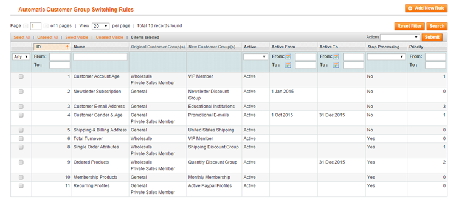

# Configuring Customer Group Switching Rules

To create and manage your customer group switching rules, navigate to **Customers > Automatic Customer Group Switching** in the top Admin Panel menu.

Add a new rule by clicking the button in the top right corner of the page, or select an existing rule from the Automatic Customer Group Switching Rules grid to modify it.

Use the following tabs of the rule view menu to create and configure your automatic group switching rules:

- [Rule Information](./05-rule-information.md)
- [Rule Conditions](./06-rule-conditions.md)
- [Rule Action](./07-rule-action.md)
- [E-mail Notifications](./08-email-notifications.md)

---

[Documentation index](./README.md) · [README](../README.md) · [Online version](https://plugin.company/knowledge-base/docs/magento-automatic-customer-group-switching/user-manual/configuring-customer-group-switching-rules/)
