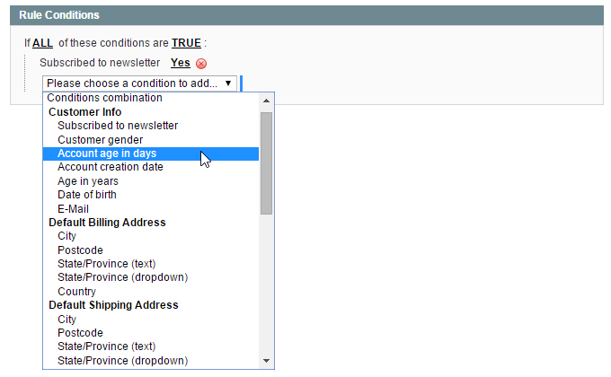
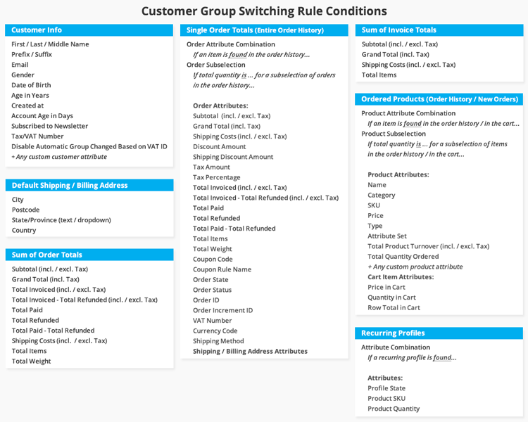
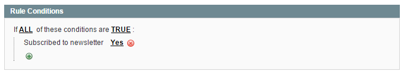
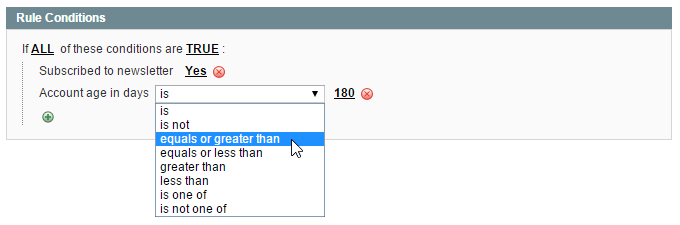
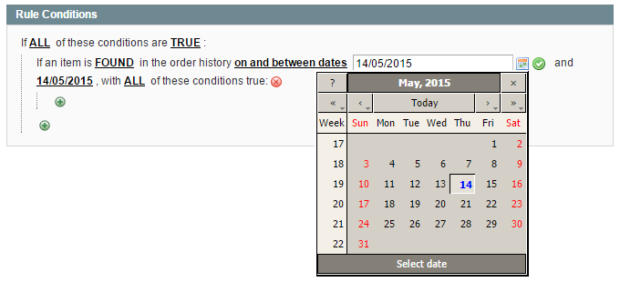
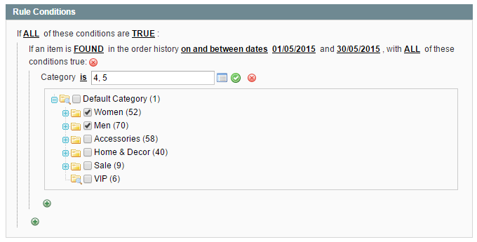
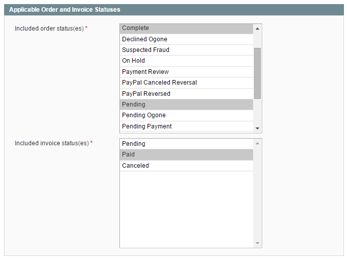

# Rule Conditions

In the Rule Conditions tab you can define the conditions that have to be met in order to automatically switch a customer to another group and select the applicable invoice and order status(es) for each rule.

## Adding Rule Conditions

Click the green + icon to select a rule condition from a categorized dropdown menu.

The group switching rule conditions are divided into the following categories:

- **Customer Info**: set up rules based on customer attributes and account information.
- **Default Billing & Shipping Address**: group customers based on their default billing or shipping address details.
- **Sum of Invoice & Order Totals**: switch customers based on aggregated sales attributes such as their monthly turnover or total shipping costs.
- **Single Order Totals**: move customers based any single order attribute combination or order subselection.
- **Ordered Products**: switch customers based on any product attribute combination or product subselection from their order history or from new orders only. Please note that you can only select product attributes that are enabled for Shopping Cart Price Rules. To enable a product attribute, go to **Catalog > Attributes > Manage Attributes** using the top Admin Panel menu. Select an attribute from the grid and enable the 'Use for Promo Rule Conditions' option in the Frontend Properties section of the Properties tab.
- **Recurring Profiles**: move customers based on their recurring PayPal profile state and product SKU/quantity.

## Configuring Rule Conditions

You can add as many conditions as you want by clicking the green + icon, or click the red x icon to remove a condition.

All underlined values in the Rule Conditions tab can be modified by clicking on them. Depending on the rule condition, you can manually enter a condition value or select one from a dropdown menu.

When configuring rules based on a specific order history time frame, you can click the calendar icon next to the input field to open a date picker.

Some condition values, such as categories and product SKUs, can be selected from a list box by clicking the list icon next to the input field.

## Applicable Order and Invoice Statuses

The applicable order and invoice status(es) for each group switching rule can be selected in the bottom section of the Rule Conditions tab. If a rule includes conditions based on order or invoice information, it will only be executed when the selected order and invoice status(es) apply.

---

[Documentation index](./README.md) · [README](../README.md) · [Online version](https://plugin.company/knowledge-base/docs/magento-automatic-customer-group-switching/user-manual/rule-conditions/)
