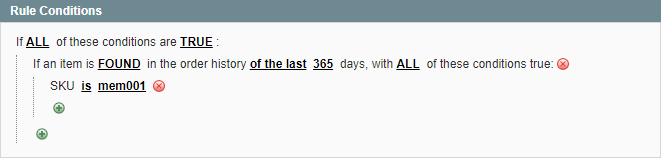
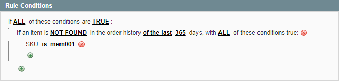

# VIP Membership Product

VIP membership management is a common use case for our [Automatic Customer Group Switcher Magento extension](https://plugin.company/magento1-extensions/automatic-customer-group-switching.html).

This tutorial will show you how to create a rule set which moves a customer to a VIP customer group after purchasing a membership product. After an x amount of days the customer will be switched back to his or her original group.

In the example we will create a rule which switches a customer to the VIP group after purchasing a specific SKU, and moves them back to the general group after one year.

## Step 1: Creating the VIP upgrade rule

Create a new rule to upgrade customers from the general group to the VIP group after purchasing a membership product.

### Rule Conditions

In the example *365 days* is the duration of the membership, and *mem001* is the SKU of the membership product.

Most likely you'll want to include the order status 'complete' and the invoice status 'paid'.

### Rule Action

The from group in our example is the 'general' group, and the to group is the 'VIP Member' group. In this case we'd like to execute the rule on customer save events and the order and invoice creation events.

## Step 2: Creating the VIP downgrade rule

Create a new rule to downgrade customers back to the general group after one year.

### Rule Conditions

The conditions are exactly the same as the rule created in step 1, except that the FOUND condition is now changed to NOT FOUND.

### Rule Action

The from group is VIP and the to group is general for this rule, which is the reverse of the first rule we created. In this case we'd like to execute the rule based on a cronjob, that way customers are switched back to the general group even if they haven't used the site for a while.

That's it, you're all set!

---

[Documentation index](./README.md) · [README](../README.md) · [Online version](https://plugin.company/knowledge-base/docs/magento-automatic-customer-group-switching/tutorials/create-a-vip-membership-rule/)
